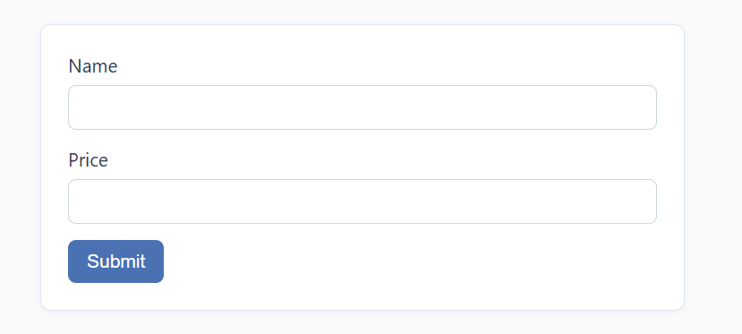
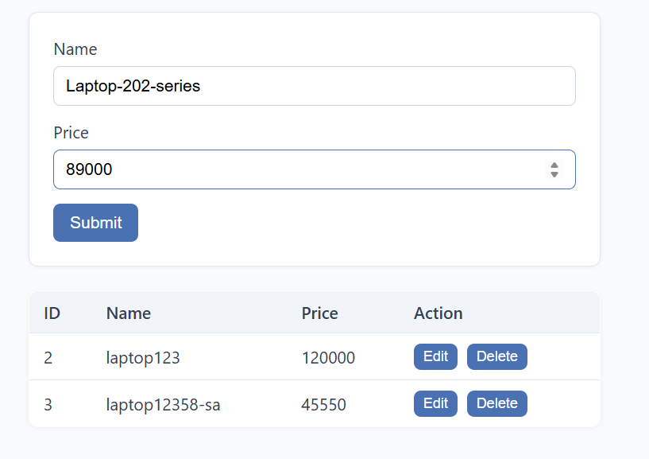
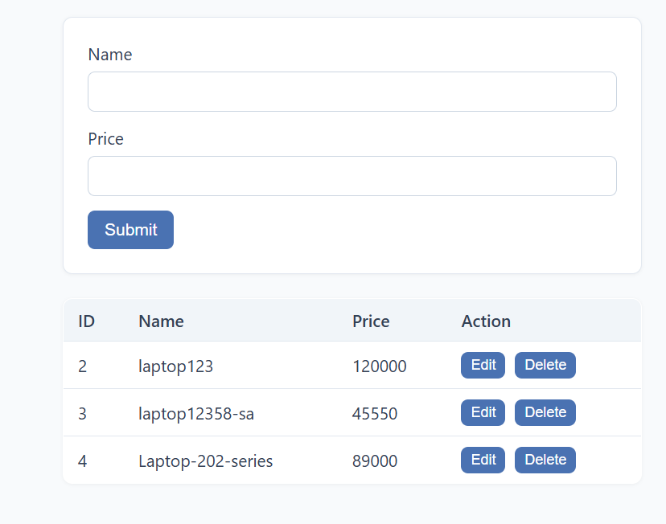
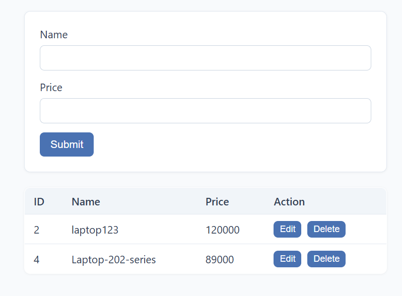

# Item CRUD Application

Front end for CRUD operations on an array of items using HTML, CSS, Express.js and REST API.

## Tech Stack

- HTML
- CSS
- JavaScript
- Node.js
- Express.js

## Project Structure

```
.
├── public/
│   ├── index.html
│   ├── script.js
│   └── style.css
├── screenshots/
│   ├── image.png
│   ├── image-copy.png
│   ├── image-copy-2.png
│   └── image-copy-3.png
├── .gitignore
├── package-lock.json
├── package.json
├── README.md
└── server.js
```

## How to Run

```bash
npm install
npm start
```

## API Endpoints

- GET /items
- POST /items
- PUT /items/:id
- DELETE /items/:id

## Screenshots


Item input form


Editing an item


Items list


Items list after deletion
